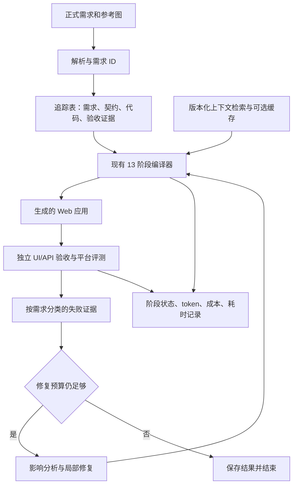

# 当前系统与拟议架构

## 已核对的代码结构

| 层次 | 代码位置 | 当前行为 |
|---|---|---|
| 调度 | main.py、infrastructure/compiler.py | 依次执行 00–12，保存 .arc/compilation.json；阶段失败后仍尝试后续阶段 |
| 需求 | infrastructure/stages/requirements/ | 需求树处理 |
| 数据库 | infrastructure/stages/database/ | schema、obligations、实现与验证 |
| 后端 | infrastructure/stages/backend/ | API 契约、测试与实现 |
| 前端 | infrastructure/stages/frontend/ui/、triggers/ | 视觉布局、交互触发与浏览器验收 |
| 智能体 | infrastructure/shared/agent/loop.py、proposals.py、recovery.py | 上下文获取、文件操作、提案与修复 |
| 检索与约定 | infrastructure/shared/rag/、shared/agent/conventions.py | BM25 和共享约定 |
| 模型与日志 | infrastructure/shared/models/、utils/presentation/ | 文本/视觉调用、usage 与日志证据 |

输出为 React + Express + SQLite 应用。本地 `input/` 当前是认证示例，**尚未验证为完整 BookStack 输入**。仓库含 arc-bench gitlink（b05825dbf3b8ad6f880d490e214145061fa2525b），本次克隆没有可用内容且未发现 .gitmodules；不能把它当作已安装评测器。

## 拟议结构（待实现）

追踪记录最小字段：requirement_id、scenario_id、contract_refs、code_refs、check_refs、status、evidence_path、run_id。可以先用 CSV/JSON 和现有 .arc 文件关联，明确字段后再决定是否抽象成模块。

现有阶段失败继续执行可能造成级联失败，也可能保留局部成果；先统计两种情况，再增加“依赖缺失时标记 blocked”规则，不直接全局改成失败即停。局部修复必须给出受影响范围，验收失败不得标记已修复。

## 平台适配优先项

用户快照要求运行时从容器 OPENAI_BASE_URL、OPENAI_API_KEY 读取模型访问参数。文本客户端已有 dotenv 默认加载；视觉客户端还允许 VISUAL_BASE_URL/VISUAL_API_KEY。平台模式应优先且仅使用平台注入的两个访问参数，不让打包的 .env 或视觉专用配置绕过计费代理；模型名由代码配置。此处是待验证/实现的适配项。

上游 main.py 是本地 CLI，不等于平台 runtime entrypoint。下载官方 Agent Template 后核对语言、文件名、函数/进程协议、输入路径、输出目录和超时，再实现适配器并放在提交 ZIP 根目录。当前不宣称已具备平台可提交包。
