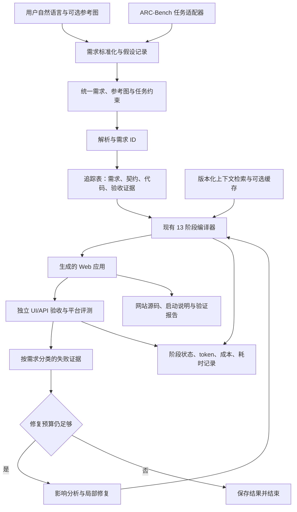

# 当前系统与拟议架构

## 已核对的代码结构

| 层次 | 代码位置 | 当前行为 |
|---|---|---|
| 调度 | main.py、infrastructure/compiler.py | 依次执行 00–12，保存 .arc/compilation.json；阶段失败后仍尝试后续阶段 |
| 需求 | infrastructure/stages/requirements/ | 需求树处理 |
| 数据库 | infrastructure/stages/database/ | schema、obligations、实现与验证 |
| 后端 | infrastructure/stages/backend/ | API 契约、测试与实现 |
| 前端 | infrastructure/stages/frontend/ui/、triggers/ | 视觉布局、交互触发与浏览器验收 |
| 智能体 | infrastructure/shared/agent/loop.py、proposals.py、recovery.py | 上下文获取、文件操作、提案与修复 |
| 检索与约定 | infrastructure/shared/rag/、shared/agent/conventions.py | BM25 和共享约定 |
| 模型与日志 | infrastructure/shared/models/、utils/presentation/ | 文本/视觉调用、usage 与日志证据 |

输出为 React + Express + SQLite 应用。本地 `input/` 当前是认证示例，**尚未验证为完整 BookStack 输入**。仓库含 arc-bench gitlink（b05825dbf3b8ad6f880d490e214145061fa2525b），本次克隆没有可用内容且未发现 .gitmodules；不能把它当作已安装评测器。

## 拟议结构（待实现）

统一入口接受用户自然语言、结构化需求和可选参考图；需求标准化层将其转成可追踪的统一表示。现有编译器接受 requirements.yaml，故自然语言到该表示的转换尚需新增，不能宣称已经支持。

本地用户入口和 ARC-Bench 适配器只负责输入/输出协议、资源位置和运行参数；共用同一网站生成核心。BookStack、Keep 等任务的实体、页面、时间和状态要求通过任务数据传入。交付层输出网站源码、依赖和启动说明、验证报告；自动发布到公网另行按用户需求安排。

追踪记录最小字段：requirement_id、scenario_id、contract_refs、code_refs、check_refs、status、evidence_path、run_id。可以先用 CSV/JSON 和现有 .arc 文件关联，明确字段后再决定是否抽象成模块。

运行记录增加 task_id、input_mode 和 agent_commit。缓存按任务与内容摘要隔离；不得将某个任务的账号、初始数据、时钟或测试预期写入公共提示词作为默认业务逻辑。自然语言模式可让用户确认歧义，自动评测模式记录假设并继续执行，不等待人工回复。

现有阶段失败继续执行可能造成级联失败，也可能保留局部成果；先统计两种情况，再增加“依赖缺失时标记 blocked”规则，不直接全局改成失败即停。局部修复必须给出受影响范围，验收失败不得标记已修复。

## 平台适配核对（2026-11-04）

已核对的调用协议为 `python3 /workspace/submission/main.py REQUIREMENTS_DIR --output-dir /workspace/template`，现有 CLI 可接受这些参数。B0 已按入口协议打包并由用户提交；日志显示任务读取、模型调用及后端生成在执行。生成模板包含 deploy.sh。完整功能与部署效果仍以最终平台评测报告为准。

模型访问使用平台注入的 OPENAI_BASE_URL、OPENAI_API_KEY；平台可能注入计费代理地址与临时 Key。B0 ZIP 不含 .env，本地模拟请求验证了注入凭据不会被同名 dotenv 值覆盖。视觉客户端仍有 VISUAL_BASE_URL/VISUAL_API_KEY 优先规则，应核对运行配置；不能由本地模拟推断线上实际注入值。

## 研究提案与当前版本

用户提供的 `agent-architecture-optimization-proposal.md` 是待实测的研究提案，审查对象为另一个上游提交（a0ad1a4a5685d11337363f37ae4c3ff3b3ab0d39，11 阶段）。当前 B0 固定在 d3da23e9897db84cfd37ce04a4ab5b38424ef399，实际是 00–12 共 13 阶段；提案里的路径与编号须先映射到本地代码。提案中的文献及产品能力引用尚未在本地逐条复核，不视为本组实测证据。

长期保留“结构化需求/契约 + 局部 Coding Agent + 真实验收 + 反馈调度”的混合方向。近期只在现有循环上做可独立验证的效率实验，见 [B1 执行计划](09-项目进展与B1执行计划.md)。
