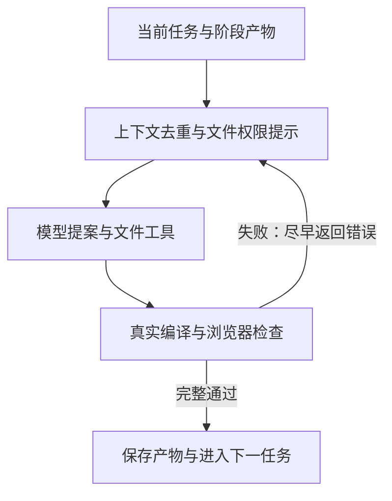

# B1：上下文复用与快速失败反馈

基于固定 B0 编译器，保留 13 阶段、需求输入、模型默认值和真实验收条件。

## 实现

1. **上下文去重**：相同的最近查询结果只在 `context_records` 保留一份，`retained_record_ids` 指向该定义；已完整提供的文件不再重复携带相同的读取片段。不同版本、不同内容和未提供的文件片段保留。
2. **文件访问提示**：受限任务向模型明确列出可读取路径，减少对受保护源文件的请求；不扩大原来的读写权限。
3. **快速失败反馈**：内部 E2E 检查使用 `--max-failures=1`，首次失败后尽快进入修复。失败及未执行用例不记作成功；修复后的全通过运行仍执行完整选定测试集。外部评测器不受影响。



## 开关与观测

| 环境变量 | 说明 |
|---|---|
| `ARC_AGENT_PROFILE=b1` | 默认启用 B1 |
| `ARC_AGENT_PROFILE=b0` | 关闭 B1 机制，保留原工作流用于对照 |
| `ARC_B1_CONTEXT_REUSE=0/1` | 单独关闭/开启上下文去重 |
| `ARC_B1_ACCESS_HINTS=0/1` | 单独关闭/开启权限提示 |
| `ARC_B1_FAIL_FAST=0/1` | 单独关闭/开启快速失败反馈 |

编译运行时 `.arc/b1_context.jsonl` 记录每次上下文去重前后的 JSON 字符数，不包含正文。它不代表完整请求 Token 或费用；Token 和成本仍使用 API usage 与实际账单。

## 本地验证

```sh
uv run python -m unittest discover -s tests -p test_b1_efficiency.py -v
```

离线机制实验使用受控的重复上下文和 8 项 Playwright 用例，不调用模型 API，不启动完整 BookStack 应用，也不生成官方成绩。

```sh
npm install --prefix releases/b1-validation @playwright/test@1.64.1 --ignore-scripts --no-audit --no-fund
uv run python team-tools/benchmark-b1.py --playwright-root releases/b1-validation --repeats 3
```

结果保存在 `releases/b1-benchmark.json`。实验分别记录失败状态的反馈耗时，以及修复后是否执行并通过全部 8 项测试；输入对照计算包含新增说明文字的字符量，不使用本地字符数估算 Token。

该机制实验不能外推为整个任务的提速或提分。正式对照需固定任务、模型与运行配置，比较 B0/B1 的官方通过率、总耗时和实际费用。快速失败会减少单次返回的错误数量，可能增加修复轮次，需同时观察。

## 打包

先提交代码，再生成版本化提交包：

```sh
uv run python team-tools/package-baseline.py --variant B1
```

输出 `releases/webapp-builder-agent-B1.zip`，包含源码版本与逐文件摘要。B0 包保留用于对照。原始 B0 打包必须在编译运行代码未修改的版本执行。
